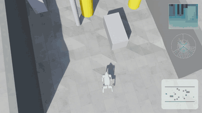
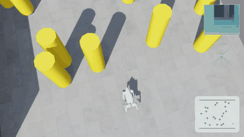
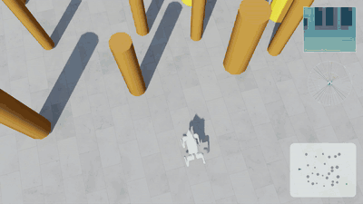
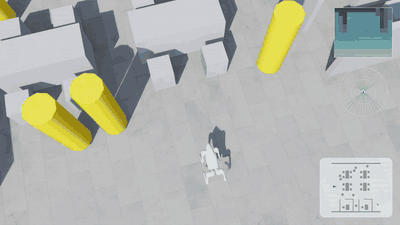
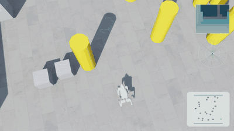

# VOP-Nav unofficial reproduction

[简体中文](README_ZH.md)

An IsaacLab reproduction of [Learning Agile Navigation in Crowded Environments for Quadruped Robots](https://arxiv.org/abs/2607.15036) for Unitree Go2. The BasicNav stage adapts [ABS — Agile But Safe](https://github.com/LeCAR-Lab/ABS) from Isaac Gym to IsaacLab. This project does not claim to match the paper or official implementation's results.

## Navigation demos

VOP-Nav policy in five simulation scenes. GIF previews show the complete recordings at the original speed.

| Training | Square |
| --- | --- |
|  |  |
| Forest | Office |
|  |  |
| Slow | |
|  | |

## Setup

Prepare an NVIDIA GPU, IsaacLab, Isaac Sim, PyTorch, NumPy, and PyYAML. IsaacLab must provide `MultiMeshRayCasterCfg` and `MultiMeshRayCasterCameraCfg`. A complete tested version matrix is not yet provided. Non-Training playback and evaluation scenes also need Python-RVO2; installation instructions are in the Chinese guide. Offline VOP-Net training does not start Isaac Sim.

```bash
export LOCAL_CONDA_ROOT="$HOME/miniconda3"
export LOCAL_CONDA_ENV="$LOCAL_CONDA_ROOT/envs/isaaclab"
source env.sh
install_env
```

`install_env` installs the four local packages with `--no-deps`; prepare third-party dependencies separately. See [runtime profiles](scripts/env/servers/README.md) for SSH/Conda and Docker configuration.

## Workflow and configuration

1. Train BasicNav.
2. Collect trajectories and prepare analytic velocity-obstacle labels.
3. Train VOP-Net offline.
4. Train VOP-Nav with a frozen VOP-Net.

Navigation uses native Python configuration in `source/envs/go2/nav_env_cfg.py`, `vop_nav_env_cfg.py`, and `agents/`. Scene definitions are shared by playback and evaluation in `source/envs/go2/evaluation/layouts.py`. Only stage two uses YAML: `configs/stage2/collect.yaml`, `train.yaml`, and `compare.yaml`.

```bash
# Installation smoke run, not a trained policy or benchmark.
train --task Unitree-Go2-VOP-BasicNav --num_envs 16 --max_iterations 2

# Fill in stage-two input paths before these commands.
collect
train_vop --epochs 50

train --task Unitree-Go2-VOP-Nav --vop_checkpoint logs/.../best.pt
```

Default navigation training runs for 6000 iterations. CLI overrides use underscores for navigation (`--num_envs`, `--max_iterations`, `--vop_checkpoint`) and stage-two options retain their existing hyphenated spelling. Run each command with `--help` for details.

After code changes, run `sync_code` explicitly before launching remote tasks. Playback and evaluation require a navigation checkpoint and its adjacent training `config.json`; VOP-Nav also requires the matching VOP-Net checkpoint.

See [README_ZH.md](README_ZH.md) for playback, evaluation, comparison exports, task management, and dependencies. 

## License

Licensed under [CC BY-NC 4.0](LICENSE) for noncommercial use. See [third-party notices](licenses/THIRD_PARTY_LICENSES) for third-party licenses.
