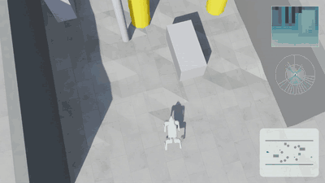
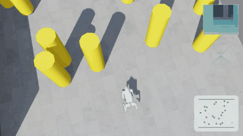
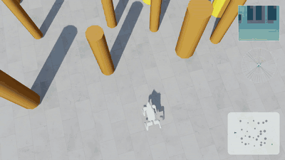
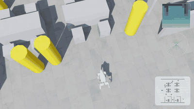
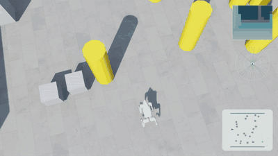

# VOP-Nav 非官方复现

[简体中文](README_ZH.md)

本项目使用 IsaacLab 训练 Go2 四足机器人，使其能够在动态障碍物中导航，目标是复现 [Learning Agile Navigation in Crowded Environments for Quadruped Robots](https://arxiv.org/abs/2607.15036) 的训练流程。

基础导航阶段参考 [ABS — Agile But Safe](https://agile-but-safe.github.io/)，基于其[官方代码](https://github.com/LeCAR-Lab/ABS)将 Isaac Gym 实现迁移到 IsaacLab。项目包含仿真适配和工具改动，目前不声称达到论文或官方实现的实验结果。

## 导航演示

VOP-Nav 策略在五种仿真场景中的表现。GIF 保留原速和完整过程。

| Training | Square |
| --- | --- |
|  |  |
| Forest | Office |
|  |  |
| Slow | |
|  | |

## 训练流程

| 阶段 | 输入 | 输出 |
| --- | --- | --- |
| BasicNav | 导航环境与 PPO 配置 | 导航策略 checkpoint |
| 采集数据 | 冻结的 BasicNav checkpoint | 校验后的原始轨迹、五帧样本、解析 VO 标签和训练分片 |
| VOP-Net | 转换后的数据集 | best / last checkpoint，以及每轮验证指标 |
| VOP-Nav | 冻结的 VOP-Net checkpoint | 新的导航策略 checkpoint |

## 环境准备与服务器选择

先手动准备 Docker 或 Conda 中的 IsaacLab、Isaac Sim、PyTorch 及其他第三方依赖。仿真需要 NVIDIA GPU，以及提供 `MultiMeshRayCasterCfg` 和 `MultiMeshRayCasterCameraCfg` 的 IsaacLab 版本。VOP-Net 离线训练和对比导出不启动 Isaac Sim，需要 PyTorch、NumPy 和 PyYAML；开启 TensorBoard 前需安装对应包。Forest、Office、Square 和 Slow 的播放、评估还需要 Python-RVO2；三个阶段的训练不需要它。

```bash
source env.sh
install_env
```

默认使用本地环境。服务器配置方法见 `scripts/env/servers/README.md`；支持 Docker、Conda 和多服务器切换。重新 source 即可选择其他配置。本地运行示例：

```bash
export LOCAL_CONDA_ROOT="$HOME/miniconda3"
export LOCAL_CONDA_ENV="$LOCAL_CONDA_ROOT/envs/isaaclab"
source env.sh --server local
install_env
```

只有 `sync_code` 执行代码同步，包含 YAML，并删除远端代码目录中本地已经移除的文件，保留日志和 checkpoint。启动任务与 `install_env` 都使用所选服务器现有代码。`install_env` 仅使用 `--no-deps` 安装四个项目包的可编辑版本，第三方依赖完全手动准备。

### 安装播放与评估依赖 Python-RVO2

先在实际执行播放、评估的服务器上进入对应 Docker 容器或激活 Conda 环境，再执行下面的命令。使用与任务相同的 Python 解释器；例如 lab 容器若使用 Isaac Sim 自带解释器，将命令中的 `python` 替换为 `/workspace/isaaclab/_isaac_sim/python.sh`。也可先在项目管理终端执行 `enter` 进入所选环境。

```bash
python -m pip install "Cython==3.3.1" "cmake<4" setuptools wheel
python -m pip install --no-deps --no-build-isolation \
  "git+https://github.com/sybrenstuvel/Python-RVO2.git@c2c46ba8d59556aa10faf03479293236efea154d"
python -c "import rvo2; print('RVO2 is ready')"
```

## 配置文件

| 文件 | 用途 |
| --- | --- |
| `configs/stage2/collect.yaml` | BasicNav checkpoint、采集规模、等级、标签与分片参数 |
| `configs/stage2/train.yaml` | 数据集、VOP-Net 网络、优化器、训练轮数与验证参数 |
| `configs/stage2/compare.yaml` | 原始轨迹、可选 VOP-Net checkpoint、环境编号及导出参数 |


## 使用命令

修改本地代码或配置后，先手动执行 `sync_code`，启动任务不会自动同步。

```bash
# 第一阶段训练
train --task Unitree-Go2-VOP-BasicNav --num_envs 1024

# 第二阶段：先填写 YAML 中的输入路径，再依次手动启动
collect
train_vop --epochs 50

# 第三阶段训练
train --task Unitree-Go2-VOP-Nav \
  --vop_checkpoint logs/.../best.pt

# 导航续训
train --task Unitree-Go2-VOP-Nav \
  --checkpoint logs/.../model_4000.pt \
  --vop_checkpoint logs/.../best.pt
```

`collect` 一次完成仿真采集、原始数据及连续性检查、标签和分片生成。默认结果目录包含 `raw/`、`prepared/`。第二阶段 `train.yaml` 的 `dataset` 可以指向整个采集目录或 `prepared/`。采集失败或被停止时不会继续转换。VOP-Net 每次从头训练，仍保存 `best.pt` 和 `last.pt`。

播放通过 `--scenario` 切换场景，支持 `Training`、`Forest`、`Office`、`Square` 和 `Slow`。默认是 `Training` 的第 9 级；`--level` 只适用于 `Training`，在其他场景中传入会报错。

```bash
# 第三阶段策略在 Forest 中播放
play --task Unitree-Go2-VOP-Nav-Play \
  --checkpoint logs/.../model_8000.pt \
  --vop_checkpoint logs/.../best.pt \
  --scenario Forest --num_envs 1 --log

# 第一阶段策略在训练场景的第 6 级播放
play --task Unitree-Go2-VOP-BasicNav-Play \
  --checkpoint logs/.../model_8000.pt \
  --scenario Training --level 6 --num_envs 1

# 第三阶段评估，多个场景共用一个入口
evaluate --task Unitree-Go2-VOP-Nav \
  --checkpoint logs/.../model_8000.pt \
  --vop_checkpoint logs/.../best.pt \
  --scenarios Forest Office Square Slow --num_envs 4
```

第三阶段播放、评估应使用训练时配套的同一份 VOP-Net 权重。导航 checkpoint 所在目录必须保留训练生成的 `config.json`，用于读取策略网络结构。

本地播放打开桌面窗口，远程播放使用 WebRTC。相机在 Isaac Sim 原生窗口中调整；切换场景需先 `stop play`，再使用新场景启动。场景障碍物数量、速度等参数统一修改 `source/envs/go2/evaluation/layouts.py`，播放和评估共用定义。

第二阶段对比通过远端导出流程使用：

```bash
compare
# 使用其他配置时显式指定
compare --config configs/stage2/compare.yaml
# 等待导出完成后下载整个目录
download exports/my_comparison
```

下载后在浏览器中直接打开 `index.html`。页面保留原始轨迹回放和解析 VO，第二阶段对比配置中填写 `checkpoint` 后同时显示网络预测。

## 任务管理

```bash
status
log train
log collect
log train_vop
log compare
stop train
stop collect
stop train_vop
stop compare
stop play
stop evaluate
tb
stop tb
```


## 许可

采用 [CC BY-NC 4.0](LICENSE)，仅限非商业用途。第三方许可见[第三方声明](licenses/THIRD_PARTY_LICENSES)。
